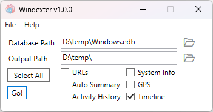

# Windexter

noun
win-dex-ter (ˈwɪndɛkstə˞r)

: an application with intellectual or academic interests or pretensions, geared towards the Windows Search Index

: a *poindexter* of an application designed for the Windows Search Index databases

## What Windexter Does

Windexter analyzes the contents of a `Windows.edb` (ESE database), `Windows.db` (SQLite database), or `Windows-gather.db` (SQLite database) and provides a legible output for forensic analysis in the form of an Excel spreadsheet.  

Older `Windows.edb` files that keep their properties in a `SystemIndex_0A` table instead of `SystemIndex_PropertyStore` (for example from Windows 7 and 8) are read as well; their 8-byte dates, sizes and durations are stored big-endian and are converted accordingly.

In these files `System.Search.AutoSummary` is stored obfuscated and compressed. Windexter reverses the obfuscation (as described in Joachim Metz's paper on the Windows Search database) and expands the text, whether it is stored one byte per character, as run-length UTF-16 or compressed with LZXPRESS Huffman. A value stored in any other way is shown as hexadecimal.

The spreadsheet will contain anywhere from one to 11 tabs, based on the database provided and the options selected:

### Indexed Results

Contains the contents of the main SystemIndex_1_PropertyStore table, correlated (when available within the database) with the SystemIndex_Gthr and SystemIndex_GthrPth tables.

When the gather data is available, the `InGather` and `GatherLastModified` columns follow the work ID. The index and the gather data are matched on the work ID, which is the same number as the gather `DocumentID`. `InGather` is `False` for an item that is in the index but has no gather record, and `GatherLastModified` is that record's last-modified time.

### Gather Data

Contains a correlation between the SystemIndex_Gthr and SystemIndex_GthrPth tables to display the full path for a file or folder, as well as the metadata which goes along with it.

The `InIndex` column follows `DocumentID` and is `False` for an item that was gathered but has no entry in the index.

`TransactionFlags` is shown as stored. The SQL Gatherer Version 2 specification (MS-SQLPGAT2) documents five of its bits for the SharePoint gatherer, but they do not describe Windows Search data: the bit that means "the item is a folder" is set on almost every row, files included. Only the bit for a valid last-modified time (`0x40`) matches what it describes, so the flags are not decoded. `SDID` is an ID into the security descriptors kept in `SecStore.db`. When `SecStore.db` is processed, the `SecurityDescriptor` and `Owner` columns follow `SDID`; they are empty for the few rows that have no `SDID` (an empty value or 4294967295).

### URL Data

Contains the filtered contents of the Indexed Results tab which shows only URL-related data.

### GPS Data

Contains the filtered contents of the Indexed Results tab which shows only GPS-related data.

### Computer Info

Contains the filtered contents of the Indexed Results tab which shows only Computer Info-related data.

### Activity

Contains the filtered contents of the Indexed Results tab which shows only Activity-related data.

### Search Summary

Contains the filtered contents of the Indexed Results tab which shows only the Search Summary-related data.

### Timeline

Contains the entirety of the Indexed Results tab, but displaying all timestamps in a single column, based on their Source (ie. System.DateCreated, System.Search.GatherTime, etc). Easily filtered and sorted.

### PropertyMap

Contains the parsed content of the PropMap.db file (when present) within the provided directory.

The `PropertyName` and `InPropertyStore` columns follow `Id`. `InPropertyStore` is `True` when the property has a column in the property store and `False` when the indexer knows the property but no value was stored for it. It is only present when the `Windows.db` is available alongside the PropMap.db.

PropMap.db only holds a property set GUID and a number for each property, so Windexter looks the name up in this order and uses the first match:

1. The name of the property's column in the Indexed Results (needs the `Windows.db`).
2. The standard Windows name (`System.…`), from the property keys published in the Windows SDK, [MS-WSP] and Microsoft Learn.
3. A name as written in another published source:
   - `PidTag…` and `PidLid…` names from [MS-OXPROPS], with several names joined by ` / ` when more than one property uses the same number.
   - `GKPIDDSI_…` names from [MS-OSHARED] for the document summary properties.
   - `PID_IS_…` names for Internet shortcuts, and `PKEY_…` names from the Windows SDK.
   - Names from the tables of the mfcmapi project.
   - Names such as `MsgSubject` from the property set tables in [MS-WSP].
   - `PKEY_…` names read from Microsoft's public symbol files for `console.dll`, `inetcomm.dll`, `propsys.dll` and `mfcore.dll`, for example `PKEY_Console_ForceV2`. These are the names of the variables in Microsoft's code, not official property names.
4. For a property identified by a name instead of a number, that name.
5. When the property has no known name but belongs to a known property set, the name of the set followed by the property's number, for example `PSETID_CalendarAssistant 15`. This is a label, not the name of the property. The label `OneNote search` is Windexter's own description for the set `{326D366E-BD3E-464C-9D9F-B2B3756E1E90}`, which OneNote's indexing filter (`ONFILTER.DLL`) uses for its section items (`ONEINDEX16://`). Microsoft has not published a name for that set or its properties 100 and 101.

`PropertyName` is empty when none of these applies. That is the case for a few properties that no published source names, mostly in property sets that belong to Windows Search itself and to OneNote.

When the PropMap.db is processed together with the `Windows.db`, Indexed Results gets an `InvertedOnlyPidNames` column after `InvertedOnlyPids`. `InvertedOnlyPids` lists the properties of an item that are indexed only in the full-text (inverted) index and have no stored value. Each number is a PropMap `Id`, or a `StandardId` when it is below 4096 (for example 20 is `System.Search.Contents`). The new column shows the `PropertyName` for each number, in the same order and separated by `|`. A number whose property has no known name stays as the number. `InvertedOnlyMD5` is a 16-byte hash of the values of those properties. How it is calculated is not known, so it can only be compared between items: equal values mean equal inverted-only content.

### Security Descriptors

Contains one row for each security descriptor in the `SecStore.db` file (when present) in or below the folder of the `Windows.db`. The `Id` is the number that the `SDID` column of Gather Data refers to. The columns are the `Owner` and `Group`, the `DaclFlags` and `SaclFlags` (for example `Auto-inherited`), the number of `AccessEntries`, the original descriptor text as `SDDL`, and the `EnterpriseIds` when there are any (none in the samples examined). Owners and groups are shown as a name and the SID, for example `Local System (S-1-5-18)`. A SID that is a local account is shown by its relative ID, for example `Account with RID 1000`, because `SecStore.db` holds no account names. App container SIDs are shown as `App package` or `App capability`.

### Security Entries

Contains one row for each access entry of each security descriptor: the `SecurityDescriptorId`, the `Entry` number, whether it is in the `DACL` or the `SACL`, the `Type` (`Allow`, `Deny`, ...), the `Trustee` SID and its `TrusteeName`, the `Access` as words, the `AccessMask` in hexadecimal, and the original `Flags` with their `Inheritance` in words. The access is named only when the mask matches a common combination (`Full control`, `Modify`, `Read and execute`, `Read`, `Write`, `Execute`); other masks are listed bit by bit as `Special: ...`. Use it to answer questions such as which items `Everyone` can write, or which items another local account has access to.

## Usage

First, extract or acquire a copy of the Windows Search Index database. This is typically located at:  
`C:\ProgramData\Microsoft\Search\Data\Applications\Windows\{Windows.db,Windows-gather.db,Windows.edb}`

Then, with Windexter open, click the Folder icon next to `Database Path` and browse to and select the location you've saved the database. Once selected, the Output path will automatically update to show the folder where the database is located, however you can change this by selecting the Folder icon next to `Output Path` and choosing a different location.

Next, select any of the checkboxes you wish to provide additional filtering / analysis. You do not *need* to select a checkbox, and if none are selected, you will get the default options containing the `Indexed Results` for the `Windows.db` and `Windows.edb` databases, or the reconstructed file paths from the `Windows-gather.db`.

The `Gather`, `PropMap` and `SecStore` checkboxes are only available when Windexter finds the matching file for the `Windows.db` you selected: a `Windows-gather.db` in the same folder, and a `PropMap.db` and a `SecStore.db` in or below that folder (`SecStore.db` is normally in `Projects\SystemIndex\SecStore`). Tick them to process those files as well and add the `Gather Data`, `PropertyMap`, `Security Descriptors` and `Security Entries` tabs. If they are not ticked, those files are ignored and nothing is asked. With the command line, use `--gather`, `--propmap` and `--secstore`. A `SecStore.db` needs its `SecStore.db-wal` file beside it when one exists.

Finally, click `Go!`. Your output will be saved as an XLSX file named either:

 `WINDOWS-SEARCH-INDEX-<yyyyMMdd HHmmss>.xlsx` (for an SQLite `Windows.db` DB)  
 `WINDOWS-SEARCH-GATHER-<yyyyMMdd HHmmss>.xlsx` (for an SQLite `Windows-gather.db`)  
 `WINDOWS-SEARCH-ESEDB-<yyyyMMdd HHmmss>.xlsx` (for an ESE DB `Windows.edb`)

### SQLite Output

Tick `SQLite` beside `Go!` (or use `--format sqlite` / `--format both` with the CLI) to save the results as a `.sqlite` database, either instead of or alongside the workbook. The file is named like the workbook, for example `WINDOWS-SEARCH-INDEX-<yyyyMMdd HHmmss>.sqlite`.

The database contains these tables:

- `IndexedResults`, `GatherData`, `PropertyMap`, `SecurityDescriptors` and `SecurityEntries`: the same data as the workbook tabs, with the same column names. Processing the `SecStore.db` makes the database larger, because the descriptor text is repeated in every `GatherData` row.
- `ExportInfo`: the tool version, export time, source file and source type.

It also contains views, which are always created when the columns they need are present, so there is no need to tick the filter boxes:

- `URLData`, `GPSData`, `ComputerInfo`, `Activity` and `SearchSummary`: the same filtered rows as the matching workbook tabs.
- `Timeline`: every date column of `IndexedResults` as `Timestamp` and `Source`, followed by the remaining columns. Sort it with `ORDER BY "Timestamp"`.

Column names contain dots, so quote them, for example `SELECT "System.ItemUrl", "System.DateCreated" FROM URLData;`. Integers and decimals are stored as numbers, booleans as 0 or 1, and everything else as text. Dates are text in `yyyy-MM-dd HH:mm:ss` form, so SQLite's date functions work on them, and binary values are shown as hexadecimal text.

### Outlook / mapi16 Items

Windows Search indexes Outlook items under `mapi16://` URLs, for example `mapi16://{SID}/corey@example.com($1b25d222)/0/Inbox/<ID>`. The item or attachment ID at the end of the URL is a binary MAPI entry ID that has been written as text, one Hangul character per byte: each byte is added to U+AC00, as described in Microsoft's [MAPI URL documentation](https://learn.microsoft.com/en-us/office/client-developer/outlook/mapi/algorithm-to-encode-entry-ids-and-attachment-ids). It appears in `System.ItemUrl`, `System.ItemPathDisplay`, `System.ItemPathDisplayNarrow` and the gather `FullPath`. In the gather data the item's `FileName` is the ID itself (`<ID>` for a message, `at=<ID>:<file name>` for an attachment).

Windexter keeps the original values and adds `DecodedItemUrl`, `DecodedItemPathDisplay`, `DecodedItemPathDisplayNarrow`, `DecodedFullPath` and `DecodedFileName` columns, each right after its original column. `DecodedFileName` is empty for a `FileName` that holds no ID. In them, every ID is replaced by its bytes in hexadecimal; the rest of the URL is unchanged. Every character of the ID is decoded, including the last one, which is a real byte (`00`) and not a terminator.

| Part | Size | Notes |
|---|---|---|
| Message ID | 24 bytes | Flags (4), store ID (16), item ID (4), for example `EF00000087BF20495580E14D82798048F3BA5ABDC4A12B00` |
| Attachment ID | 4 bytes | Follows `/at=` and is followed by `:` and the file name, for example `at=25800000:ATT00001.txt` |

The layout is the entry ID of an Outlook data file, specified in [MS-PST] section 2.4.3.2.

- **Flags:** `00000000` for some stores and `EF000000` for others in the samples examined. [MS-PST] says these bytes are zero, so what `EF` means is not documented.
- **Store ID:** the provider UID, which is the `PidTagRecordKey` of the store. It is the same in every item of a store and different for each store, so it can be used to group items by account. It is not the `($1b25d222)` value in the URL, which is a hash of the store.
- **Item ID:** the node ID (NID) of the item inside the data file, a 4-byte little-endian number. The low 5 bits are the node type (4 for a normal message, 5 for an attachment, as in every sample) and the rest is an index that counts up from 65,536 in the samples.

An ID is recognised as a run of three or more characters between U+AC00 and U+ACFF that ends in U+AC00, so a folder name written only with those Hangul syllables and ending in 가 could be mistaken for one.

The `($1b25d222)` part of the URL is a 32-bit hash of the store, calculated as described in Microsoft's [store hash documentation](https://learn.microsoft.com/en-us/office/client-developer/outlook/mapi/algorithm-to-calculate-the-store-hash-number). It needs the store's own entry ID, which is not in the index, so it cannot be recalculated from the index and is left as it is. The `0` after it is the store type (`0` is the default store).

`System.Message.ConversationIndex` is shown as hexadecimal. Its layout is documented in [MS-OXOMSG] (a 22-byte header followed by 5-byte blocks), and the values in the samples follow it, but the time in the header is a plausible date for only about one value in six, so it is not decoded.

## Project Details

This application was written in C#, utilizing the Windows Presentation Framework (WPF), and relies on [libesedb](https://github.com/libyal/libesedb/) project by Joachim Metz for easy access to the contents of the ESE database without the use of an API, and without the need to recover / repair for access. It also uses the [SQLitePCLRaw](https://github.com/ericsink/SQLitePCL.raw) library to enable read-only access to the SQLite databases.  
The Excel output is generated using the [ClosedXML](https://github.com/ClosedXML/ClosedXML) package, which is MIT licensed.  
The third-party components that ship with Windexter, and their licences, are listed in `THIRD-PARTY-NOTICES.md`.

[MS-OXPROPS]: https://learn.microsoft.com/en-us/openspecs/exchange_server_protocols/ms-oxprops/f6ab1613-aefe-447d-a49c-18217230b148
[MS-OXOMSG]: https://learn.microsoft.com/en-us/openspecs/exchange_server_protocols/ms-oxomsg/daa9120f-f325-4afb-a738-28f91049ab3c
[MS-OSHARED]: https://learn.microsoft.com/en-us/openspecs/office_file_formats/ms-oshared/d93502fa-5b8f-4f47-a3fe-5574046f4b8d
[MS-PST]: https://learn.microsoft.com/en-us/openspecs/office_file_formats/ms-pst/141923d5-15ab-4ef1-a524-6dce75aae546
[MS-WSP]: https://learn.microsoft.com/en-us/openspecs/windows_protocols/ms-wsp/67328dcc-4e12-4e1e-be80-d91684df2f98
